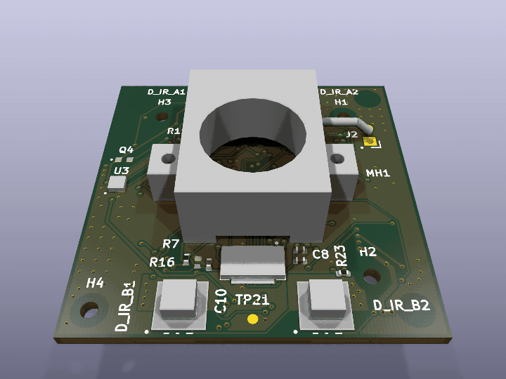

<!-- 수치는 저장소 결과 파일에서 읽은 값이다(기준 커밋 main 1898e1f, 2026-11-27). 값마다 출처 경로를 표 각주와 docs/readme/*.svg 주석에 적었다. -->

# OpenHW — SG2002 엣지 AI 카메라

**구매한 SG2002 코어 모듈에 직접 설계한 PCB 두 장을 붙이고, 렌즈·IR-cut·IR 조명까지 한 몸으로 묶은 오픈 하드웨어 카메라 PoC**

> **English summary**
> OpenHW is an open-hardware edge-AI camera proof of concept built around the SG2002 SoC.
> A purchased core module (reCamera Core 2002) sits between two boards we designed in KiCad 10:
> a 40×40 mm front board (image sensor, M12 lens, IR-cut filter, 850 nm IR LEDs, ambient light sensor)
> and a 40×54 mm carrier board (12 V input and protection, 5 V buck, 10/100 Ethernet, USB-C, microSD).
> The device runs Linux and detects people on the on-chip NPU.
> The project is in the virtual-design stage: schematics pass ERC with zero violations, 25 of 25 circuit simulations pass,
> and the front board passes DRC with zero violations and zero unconnected items, while carrier routing is still in progress.
> Hardware design files are released under the Apache License 2.0.

## 무엇인가

- **엣지 AI 카메라 노드**다. 카메라 영상을 보드 안의 NPU로 바로 분석해 사람을 감지하고, 이벤트를 유선 이더넷으로 보낸다.
- **세 층으로 쌓는다.** 아래부터 차례로 다음과 같다.
  - 캐리어 보드(직접 설계)
  - SG2002 코어 모듈(구매품, reCamera Core 2002)
  - 전면 보드(직접 설계)
- 보드 사이는 0.5 mm 60핀 BTB 커넥터로 바로 꽂고, 전면과 캐리어 사이 전원·제어는 GH 6핀 하니스로 잇는다.
- **광학을 보드 설계에 함께 넣었다.**
  - M12 고정초점 렌즈(수평 화각 약 90°)의 광축을 PCB 배치 기준으로 삼았다.
  - 광학 부품은 주야 전환용 IR-cut 필터, 850 nm IR LED(자리 4개, PoC는 2개 실장), 주야 판별용 조도센서다.
- **지금은 가상 설계 단계다.** 회로도·시뮬레이션·PCB·3D 조립 검증까지 컴퓨터 안에서 끝내는 것이 목표이고, 실물 제작은 그 뒤다.

## 한눈에 보기

> 그림은 움직이는 SVG다. 운영체제에서 「동작 줄이기」를 켜면 멈춘 그림으로 보인다. 밝은·어두운 테마를 따른다.

## 사양

| 항목 | 전면 보드 | 캐리어 보드 | 코어 모듈 (구매품) |
|---|---|---|---|
| 크기 | 40 × 40 mm | 40 × 54 mm | — |
| 층 · 두께 | 4층 · 1.6 mm | 4층 · 1.6 mm | — |
| 주요 부품 | 이미지 센서 모듈 GC2053 (2 MP, MIPI CSI, 24핀 BTB) · 24 MHz 발진기 · IR-cut 구동 DRV8837 · IR LED 구동 AL8860 ×2 · 850 nm IR LED 자리 4개 (2직렬 × 2줄, PoC는 1줄 실장) · 조도센서 LTR-329 · 2.8 V LDO | 12 V DC 잭 · 퓨즈·역접속 보호 · eFuse TPS26600 (IR 전원) · 5 V 강압 TPS54302 · RJ45 10/100 · USB-C · microSD · 디버그 UART · ESD 보호 | SG2002 SoC (NPU) · 8 GB |
| 보드 간 연결 | BTB 60핀 (암) · GH 6핀 | BTB 60핀 (수) · GH 6핀 | BTB 60핀 ×2 |
| 풋프린트 수 | 100 (시험점 포함) | 103 (시험점 포함) | — |

| 시스템 | 값 |
|---|---|
| 입력 전원 | 12 V DC |
| 네트워크 | 유선 이더넷 10/100 |
| 저장 | 이벤트 전송 기본 + microSD 슬롯 |
| 운영체제 | Linux (벤더 커널 5.10) |
| 감지 | 사람 감지 — YOLOX-Nano, NPU용 BF16 모델 |
| BTB 결합 높이 | 8.0 mm |

출처: [D-003 작업 기본값](docs/decisions/D-003-working-defaults.md) #1 #4 #5 #7 #8 #10 #11 #15 #17 #19 #21 #25 #44 · 보드 파일 [`carrier.kicad_pcb`](hardware/schematic/carrier/carrier.kicad_pcb) · [`front.kicad_pcb`](hardware/schematic/front/front.kicad_pcb)(부품 값·풋프린트 수·층 수) · [`params.md`](mechanical/m003/params.md)(btb_h 8.0)

## 진행 현황

2026-11-27 기준이다. 표시는 저장소의 결과 파일 값을 따른다.

- [x] 제품 기획과 작업 기본값 — [`product-brief.md`](docs/planning/product-brief.md), [`D-003`](docs/decisions/D-003-working-defaults.md)
- [x] 회로도 2장 ERC 위반 0 — [`carrier-erc.json`](hardware/schematic/carrier/carrier-erc.json) · [`front-erc.json`](hardware/schematic/front/front-erc.json)
- [x] 회로 시뮬레이션 25/25 통과 (ngspice-47) — [`hardware/sim/results/`](hardware/sim/results)
- [x] 전면 보드 DRC 위반 0 · 미연결 0 · 회로도 일치 0 — [`front-drc.json`](hardware/pcb/drc/front-drc.json)
- [ ] 캐리어 보드 배선 마무리 — 현재 DRC 위반 7 · 미연결 35 — [`carrier-drc.json`](hardware/pcb/drc/carrier-drc.json)
- [x] 3D 모델 빠짐 0 · 조립 판정 실패 0 (중간 보드 기준, 최종 보드로 다시 판정 예정) — [`judge.md`](mechanical/m007/judge.md)
- [ ] 케이스 — 1차 설계 [`m003-enclosure.md`](mechanical/m003/m003-enclosure.md), 최종 보드 기준 확정 대기
- [ ] 최종 렌더
- [ ] 실물 제작과 bring-up (가상 설계가 끝난 뒤)

## 저장소 지도

| 폴더 | 내용 |
|---|---|
| [`hardware/schematic/`](hardware/schematic) | KiCad 프로젝트 2개(`carrier/`, `front/`) — 회로도·PCB·ERC 결과 |
| [`hardware/pcb/`](hardware/pcb) | PCB 규칙·DRC 결과·STEP·배치 계획과 배선 도구 |
| [`hardware/libraries/`](hardware/libraries) | 프로젝트 심벌·풋프린트 라이브러리와 파생 고지 |
| [`hardware/sim/`](hardware/sim) | 회로 시뮬레이션 넷리스트·결과·파형 |
| [`hardware/datasheets/`](hardware/datasheets) | 공개 라이선스 데이터시트·참고 설계 원본과 [목록](hardware/datasheets/INDEX.md) |
| [`firmware/`](firmware) | Linux 이미지 패치·앱(사람 감지, 주야 전환)·모델 |
| [`mechanical/`](mechanical) | 적층 기준 모델·조립 판정·케이스 설계 |
| [`docs/`](docs) | 기획(`planning/`), 결정(`decisions/`), 조사(`research/`), 검토(`review/`), 이 README의 그림(`readme/`) |
| [`manufacturing/`](manufacturing) | 부품표(BOM) 정리 |
| [`validation/`](validation) | 독립 검토 기록 |

그 밖의 점(.)으로 시작하는 폴더와 자동화 폴더는 작업 환경 설정이며 설계 내용이 아니다.

### KiCad로 열기

1. KiCad 10을 설치한다.
2. `hardware/schematic/front/front.kicad_pro` 또는 `hardware/schematic/carrier/carrier.kicad_pro`를 연다.
3. 프로젝트 라이브러리는 각 프로젝트의 `fp-lib-table`·`sym-lib-table`이 저장소 안 경로로 잡는다.

## 검증 방법

모든 판정은 도구의 종료 코드와 결과 파일로 한다. 그림이나 의견으로 통과를 정하지 않는다.

| 검사 | 명령 (저장소 루트) | 결과 파일 |
|---|---|---|
| ERC | `kicad-cli sch erc --severity-all --exit-code-violations --format json -o hardware/schematic/front/front-erc.json hardware/schematic/front/front.kicad_sch` | `hardware/schematic/*/*-erc.json` |
| DRC | `kicad-cli pcb drc --format json --severity-all --schematic-parity --exit-code-violations -o hardware/pcb/drc/front-drc.json hardware/schematic/front/front.kicad_pcb` | `hardware/pcb/drc/*-drc.json` |
| 회로 시뮬레이션 | [`hardware/sim/README.md`](hardware/sim/README.md)의 실행 방법 (종료 코드 = fail + error 수) | `hardware/sim/results/SIM-*.json` |
| 3D 조립 판정 | `python -I -B mechanical/m007/run_all.py` (종료 코드 = 불합격 수) | [`mechanical/m007/judge.md`](mechanical/m007/judge.md) |

캐리어는 위 명령의 `front`를 `carrier`로 바꾼다. ERC·DRC는 위반이 있으면 종료 코드가 0이 아니다.

## 결정 기록

설계 중 갈림길마다 「분기점 · 선택 · 이유 · 차선책」을 남겼다.

- [D-003 작업 기본값](docs/decisions/D-003-working-defaults.md) — 센서·전원·적층·규칙 등 50여 개 결정
- [D-001 SoC 선택](docs/decisions/D-001-soc.md) · [D-002 모듈 + 캐리어 구조](docs/decisions/D-002-module-carrier.md) · [HW/FW 인터페이스](docs/decisions/hw-fw-interface.md)

## 라이선스 · 제3자 고지

- 이 저장소의 설계 파일과 문서는 [Apache License 2.0](LICENSE)을 따른다.
- 제3자 자료는 각 폴더의 라이선스를 그대로 유지한다. 저작권 표기는 각 폴더의 `LICENSE*` 파일 원문을 따른다. 근거는 [`hardware/datasheets/INDEX.md`](hardware/datasheets/INDEX.md)다.

| 경로 | 라이선스 | 비고 |
|---|---|---|
| `hardware/datasheets/sophgo/` | BSD 2-Clause | SG2002 데이터시트·TRM·참고 회로도 원본 |
| `hardware/datasheets/seeed/` | Apache 2.0 (저장소) · 코어 회로도 PDF는 CC BY-SA 4.0 | 참고 전용 원본. 수정하지 않았다 |
| `hardware/datasheets/antmicro/` | Apache 2.0 | 참고 풋프린트 원본 |
| `hardware/libraries/` 파생 풋프린트 | Apache 2.0 | 원저작물 고지는 [`hardware/libraries/README.md`](hardware/libraries/README.md) · [`licenses/Apache-2.0.txt`](hardware/libraries/licenses/Apache-2.0.txt) |
| 사람 감지 모델 YOLOX-Nano | Apache 2.0 | [D-003](docs/decisions/D-003-working-defaults.md) #19 |

라이선스가 표기되지 않았거나 배포가 제한된 데이터시트는 저장소에 넣지 않았고, 링크와 sha256만 [INDEX.md](hardware/datasheets/INDEX.md)에 남겼다.
