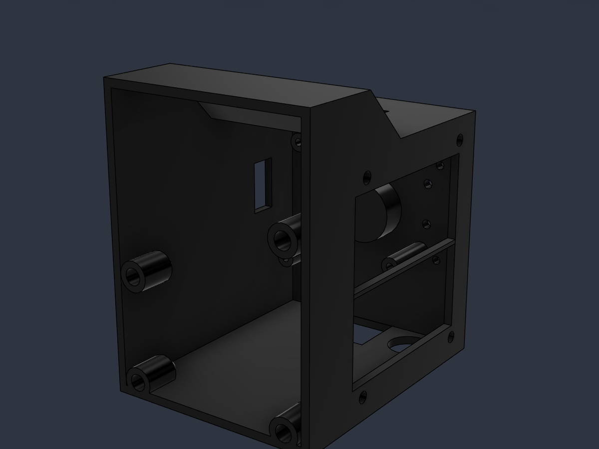
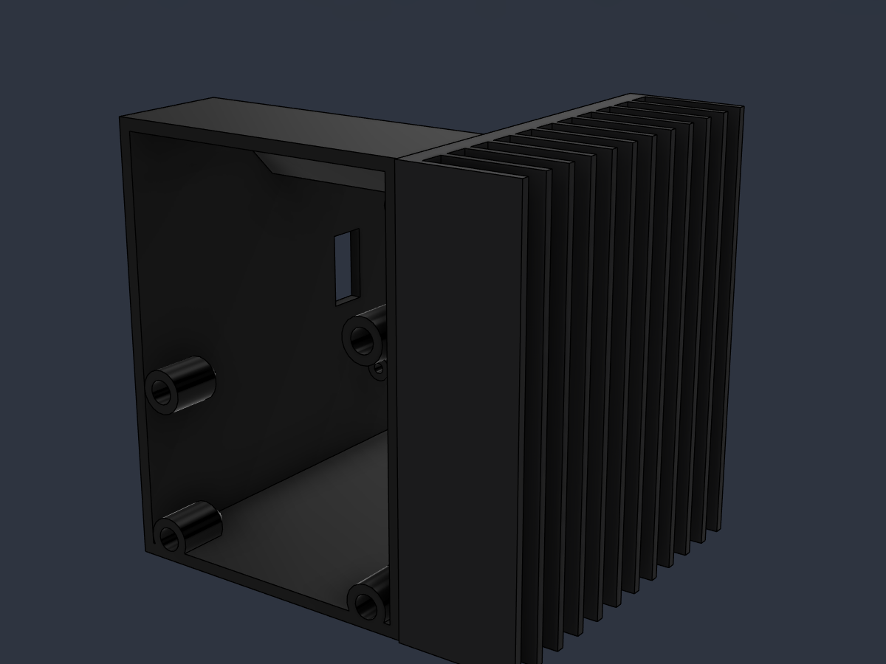
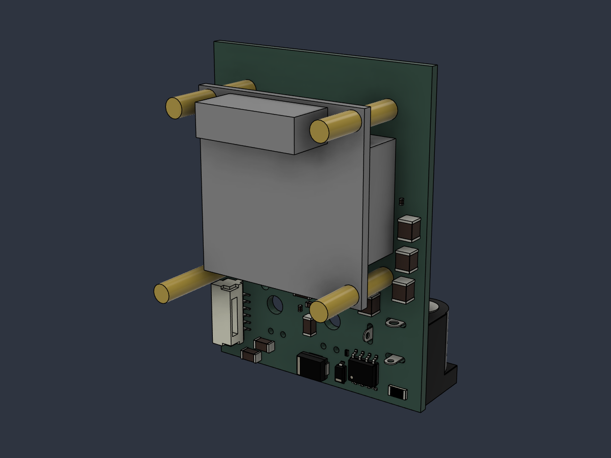
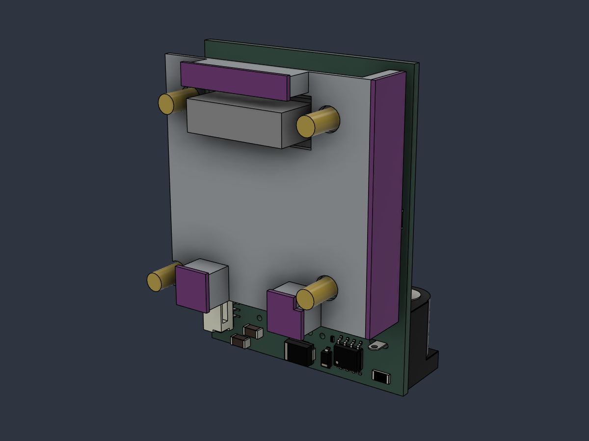
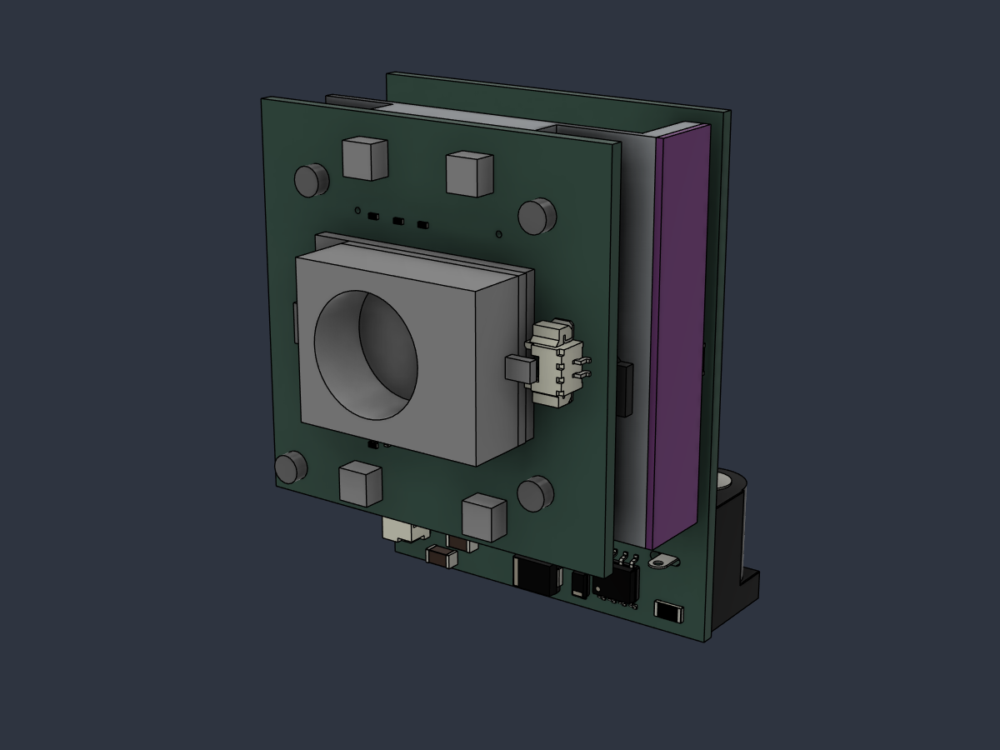
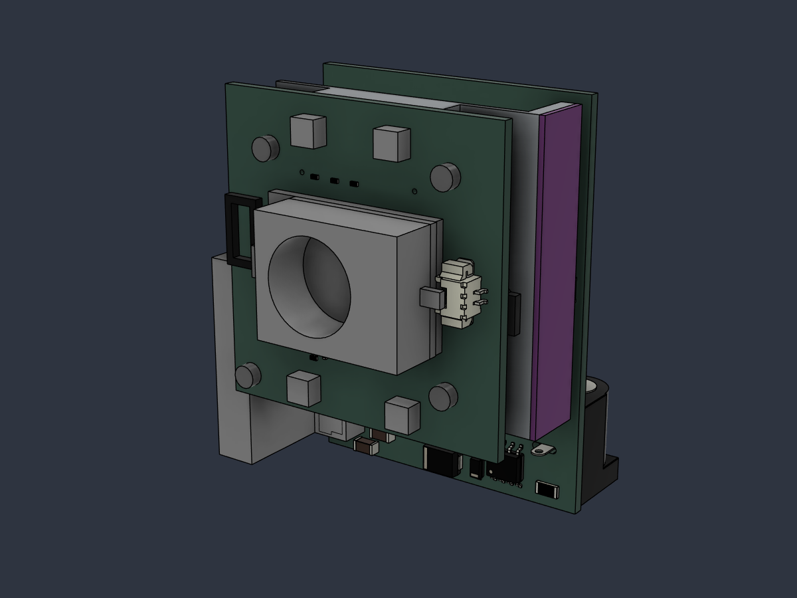
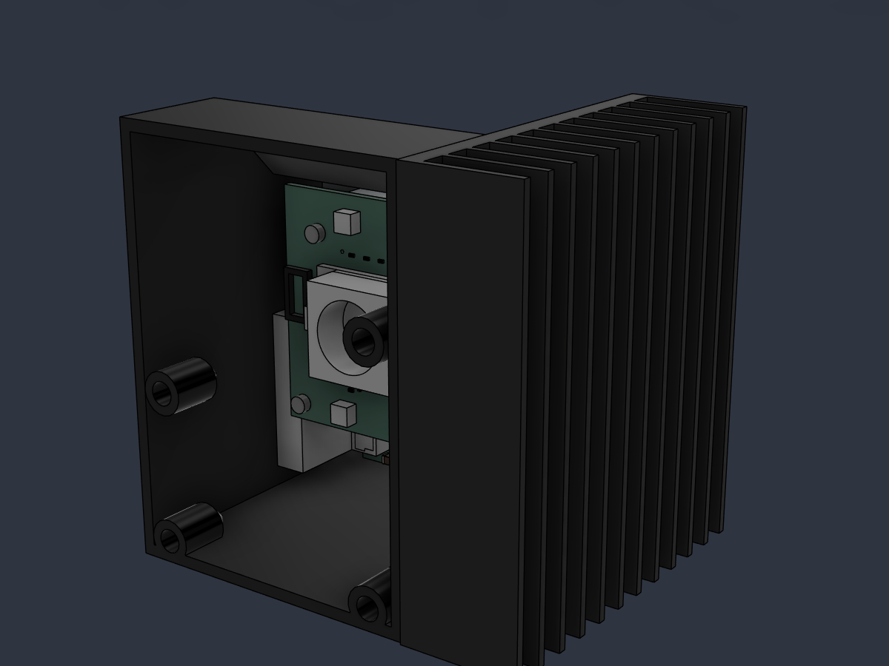
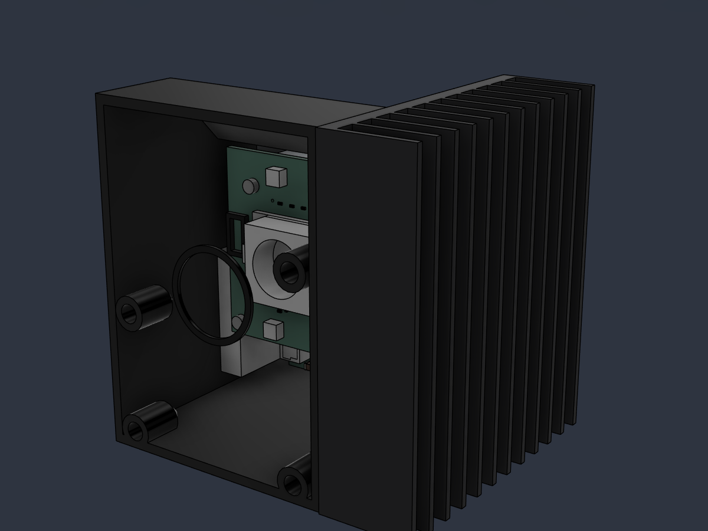
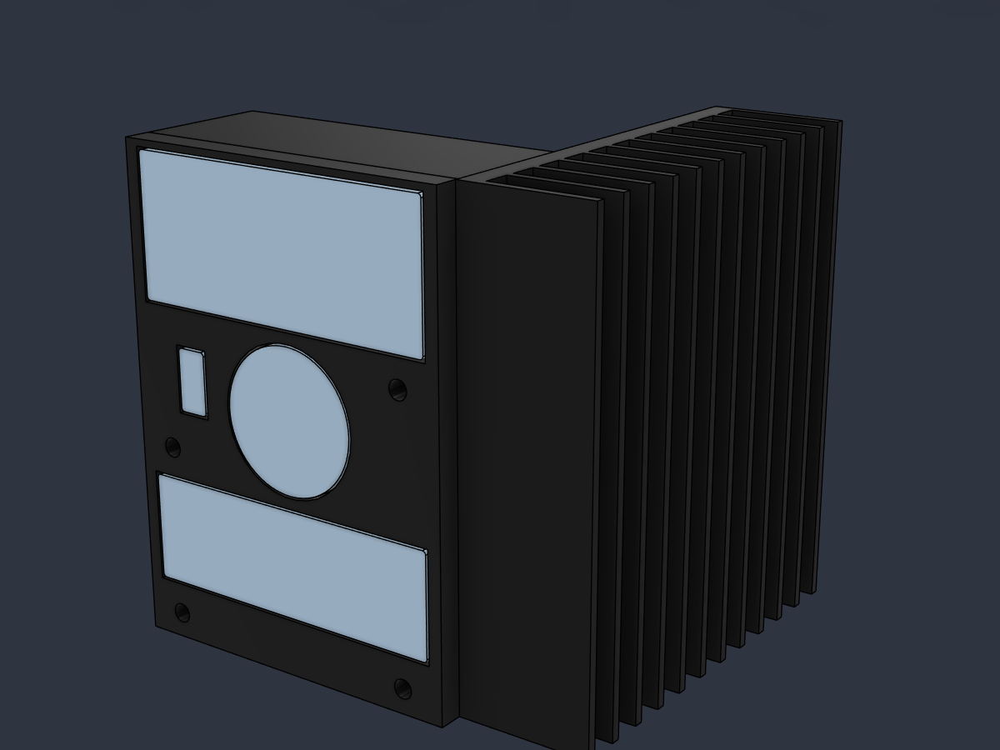

# M-003c 조립 절차서

- 순서 번호 ①~⑨는 `drawing/m003-assembly.pdf`(M-003 2차 조립도)와 같다. 괄호 안 숫자는 부품표 `bom.md` 번호다.
- 그림은 단계마다 Fusion 렌더다(`render/steps/step_N.png`, 사진 대신). 화면 위쪽 = +Y(센서 세로), 앞 = +Z.
- 좌표·치수는 `params.py` 기준(mm)이다. 작성: mechanical t18x · 2026-11-27.

## 0. 공구·조임 토크

| 체결 | 나사 | 상대 | 토크 (N·m) | 근거 |
|---|---|---|---|---|
| 전면 보드 위 | M1.6 × 4 (18) ×4 | 황동 스탠드오프 M-F 암나사 | **0.08** | A2-70 μ 0.10 표 0.1 N·m (TR Fastenings 「Stainless steel pre-load and tightening torques」, 원문 확인 2026-11-27) × 0.8 — 황동 암나사라 낮춤 [가정] |
| 스탠드오프 M-F → F-F (코어 끼움) | M1.6 수나사 ×3 | 황동 | **0.08** | 위와 같음 [가정] |
| 뒤 → 캐리어 | M1.6 × 8 (19) ×4 + 와셔 | 황동 F-F 스탠드오프 (머리 아래는 PETG 기둥) | **0.05** | 0.1 N·m의 절반 — 머리 아래 PETG 크리프 [가정] |
| 덮개 → 본체 | M2.5 × 8 (16) ×4 | 열압입 황동 인서트 in PETG | **0.25** | A2-70 μ 0.10 0.45 N·m × 0.55 — 덮개 PETG 4.2를 누름. 인서트 빠짐은 M3 시험에서 볼트보다 강함(CNC Kitchen 시험, 2차 출처) [가정] |
| 방열판 → 본체 +X 벽 (안쪽에서) | M2.5 × 5 (17) ×4 | Al 바닥 탭 3.5 (머리 아래 PETG 벽 2) | **0.30** | 0.45 × 0.65 — 머리 쪽 PETG 크리프 [가정] |
| 받침대 판 → 압출 바닥 | M2.5 × 6 접시머리 (27) ×2 | Al 탭 | **0.30** | Al끼리라 0.45까지 가능하지만 탭 3.5 물림이라 낮춤 [가정] |
| 삼각대 | 1/4"-20 | 열압입 인서트 | 손 조임 | — |

- 토크 드라이버: 0.05~0.5 N·m 범위(정밀 토크 드라이버)
- 인두: 245 °C(PETG), M2.5·1/4" 인서트 팁
- 니퍼·줄, 이소프로필 알코올(패드·폼 붙이는 면 닦기)

## ① 본체 준비

1. 본체(1)의 **+X 창 가운데 희생 기둥**(`PRINT_TAB_PX_WIN`, 폭 1.0)을 니퍼로 자르고 줄로 면을 맞춘다.
2. 덮개 나사 보스 4곳에 M2.5 인서트(14)를 245 °C 인두로 넣는다. 약 90%까지 넣고 나머지는 평평한 공구로 눌러 면을 맞춘다.
3. 뒤 (0, −4)에 1/4"-20 인서트(15)를 같은 방법으로 넣는다.
- 확인: 인서트 윗면이 보스 면과 같은 높이(±0.1). 기둥 구멍 Ø1.9에 M1.6이 통과한다(print-prep §3 F5).

## ② 바깥 방열판 (M-005: 기성 압출 SK 444 + 받침대 판)

1. 받침대 판(26)을 압출재(3) 바닥 안쪽 면에 얹는다. 사이에 열 그리스를 얇게 바른다. M2.5 × 6 접시머리(27) 2개로 고정한다(토크 0.30). 머리가 받침대 면보다 튀어나오지 않아야 한다.
2. 받침대 판을 +X 창(42.0 × 43.0)에 밖에서 끼운다. 받침대 안쪽 면이 x 20.75에 온다.
3. **본체 안쪽에서** M2.5 × 5 냄비머리(17) 4개를 벽 구멍 Ø2.8로 넣어 압출 바닥 탭에 체결한다(토크 0.30). 핀 간격 4.15가 머리 Ø4.5보다 좁아 바깥에서는 넣지 못한다.
   - 위치 (y, z) = (−31, −19.03), (17, −19.03), (−31, 19.85), (17, 19.85)
- 확인:
  - 받침대와 창 사이 틈이 사방 0.3 안팎이고 닿지 않는다.
  - 핀이 세로(Y 방향)다.
  - 압출재가 외함 Y 전체(−36.5 … 34.5)를 덮는다. +Y 아래쪽은 벽 없이 4 mm쯤 떠 있는 것이 정상이다.

## ③ 캐리어 + 코어

1. 캐리어 윗면 구멍 (13, 13), (13, −13), (−13, 13)에 F-F 8.0(21)을, (−17, −17)에 F-F 17.6(22)를 세운다. 아래 나사는 ⑦에서 본체 뒤로 넣으므로 지금은 얹기만 한다.
2. 코어를 BTB(J2 ↔ 캐리어 J1)로 수직으로 꽂는다. 코어 구멍 3곳이 F-F 위에 온다.

## ④ 방열판(내부)과 패드

1. 패드는 아래 순서로 붙인다. 붙일 면은 이소프로필 알코올로 닦는다.
   1. SoC 열 패드(13)를 코어 SoC 위에 붙인다.
   2. 절연 패드 Tflex P340(11) 3장을 방열판 기둥 윗면에 붙인다(A, B1, B2 — B2는 모서리 따낸 것). PI 쪽 투명 라이너를 먼저 떼고, **PI 면이 Al 기둥 쪽**이다. 그다음 패드를 접듯이 엠보 라이너에서 떼어 내 붙이고, 바로 덮어 먼지를 막는다(Laird 「Tflex P300 Directions for Use」 A17197-00).
   3. 옆 갭 패드 P340(12)을 +X 플랜지 바깥 면(39.0 × 8.4)에 붙인다. **라이너 면이 바깥(방열판 받침대 쪽)** 이다. ⑦에서 미끄러지며 들어갈 면이다.
2. 방열판(4)의 Ø4.0 구멍 4곳을 스탠드오프 자리에 맞춰 코어 위에 얹는다.

## ⑤ 전면 보드

1. M-F 8.0(20) 3개를 방열판 구멍으로 넣어 코어 구멍을 지나 아래 F-F에 체결한다. 토크 0.08. 이것으로 코어가 고정된다.
2. 전면 보드를 BTB(전면 J1 ↔ 코어 J1)로 꽂는다. 절연 패드가 전면 아랫면 TP 패드에 닿는다.
3. M1.6 × 4(18) 4개로 전면을 고정한다. 토크 0.08.
- 확인: 전면 보드가 평평하다(BTB가 끝까지 들어감). 절연 패드가 TP_A1·A2·B1·B2를 덮는다(밀림 없음).

## ⑥ 하니스·ALS 개스킷

1. GH 6P 하니스 35 mm(23)를 캐리어 J7과 전면 J4에 꽂는다. 두 커넥터 모두 **−X 쪽 입구**로, 하니스는 −X 통로(x −24.75…−19)로 U자로 지난다.
   - 핀 순서(K23)는 orch 결정을 따른다: 1↔1 엇갈림 배선 또는 1↔6.
2. ALS 흑색 폼 개스킷(10, 1.6t)을 전면 윗면 ALS(U3·Q4) 둘레에 붙인다. 바깥 5.0 × 9.0, 안 3.0 × 7.0.
- 확인: 하니스가 방열판 −X 끝(x −18)과 코어 바깥에 있고, 커넥터에 당기는 힘이 없다.

## ⑦ 적층을 본체에

1. 적층을 본체 앞(열린 쪽)에서 수직으로 넣는다. 옆 갭 패드가 방열판 받침대 면을 따라 미끄러지며 0.75로 눌린다. 커넥터(RJ45·DC·USB-C·microSD)가 각 개구 앞에 온다.
2. 캐리어 아랫면이 기둥 4개에 닿으면, 뒤 카운터보어로 M1.6 × 8(19)과 와셔를 넣어 스탠드오프 아래 암나사에 체결한다. 토크 0.05.
- 확인:
  - RJ45·DC·USB-C 플러그와 microSD 카드를 실제로 꽂아 본다(print-prep §3 F11).
  - 상태 LED·버튼 구멍이 맞는다.

## ⑧ 렌즈 초점·폼 링

1. 화면을 보며 렌즈를 돌려 초점을 맞춘다. 홀더 물림 약 3.3이 남는 범위 안(M-001 §3.2).
2. 저강도 나사 고정제(25)를 바른다.
3. 흑색 폼 렌즈 링(9, ID 16.4 / OD 19.0 × 1.0)을 렌즈 머리 앞면에 붙인다. 덮개를 닫으면 0.7로 눌린다(30%).

## ⑨ 창·덮개

1. 창 PMMA 4장(5~8)의 보호지를 떼고, 덮개 바깥 주머니에 붙인다(24: 투명 양면 테이프 또는 UV 접착 — 미정). 지문이 묻지 않게 둘레만 잡는다.
   - 렌즈 창 Ø20.6
   - LED A 47.05 × 20.60
   - LED B 47.05 × 15.50
   - ALS 4.50 × 9.00 (1.5t)
2. 덮개를 본체에 얹고 M2.5 × 8(16) 4개로 고정한다. 토크 0.25, 대각선 순서.
- 확인:
  - 덮개와 본체 사이 틈이 고르다.
  - 화면 가장자리에 덮개·렌즈 관 그림자(비네팅)가 없다.
  - IR LED를 켰을 때 화면에 빛샘(뿌연 빛·고스트)이 없다(I3).

## 마지막 확인표

| 항목 | 방법 | verifiable |
|---|---|---|
| 나사 토크 | 토크 드라이버 값 기록 | 예 (기록) |
| 커넥터·카드 끼움 | 실제 꽂아 봄 | 아니오 (사람) |
| 빛샘·비네팅 | IR 켜고 어두운 곳 영상 | 아니오 (사람 눈, I3) |
| 방열판 온도 | 열전대, 듀티 25% 30분 | 예 (측정값) |
| 덮개 틈·외관 | 눈으로 | 아니오 |
